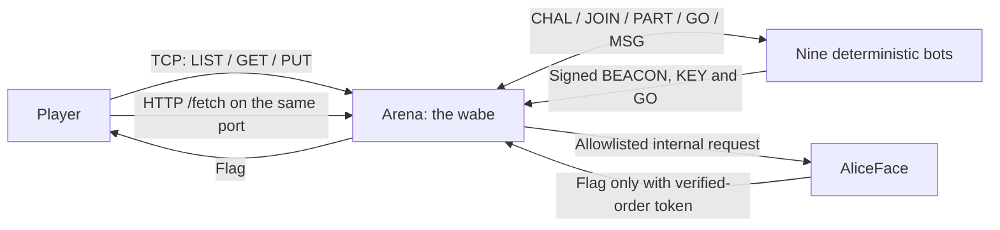
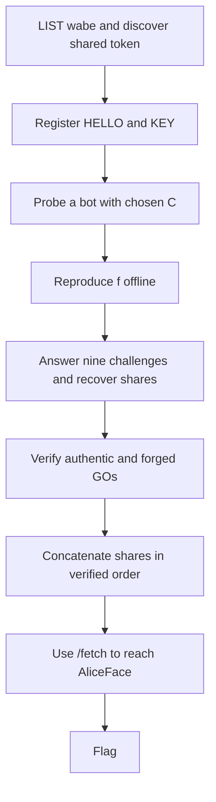
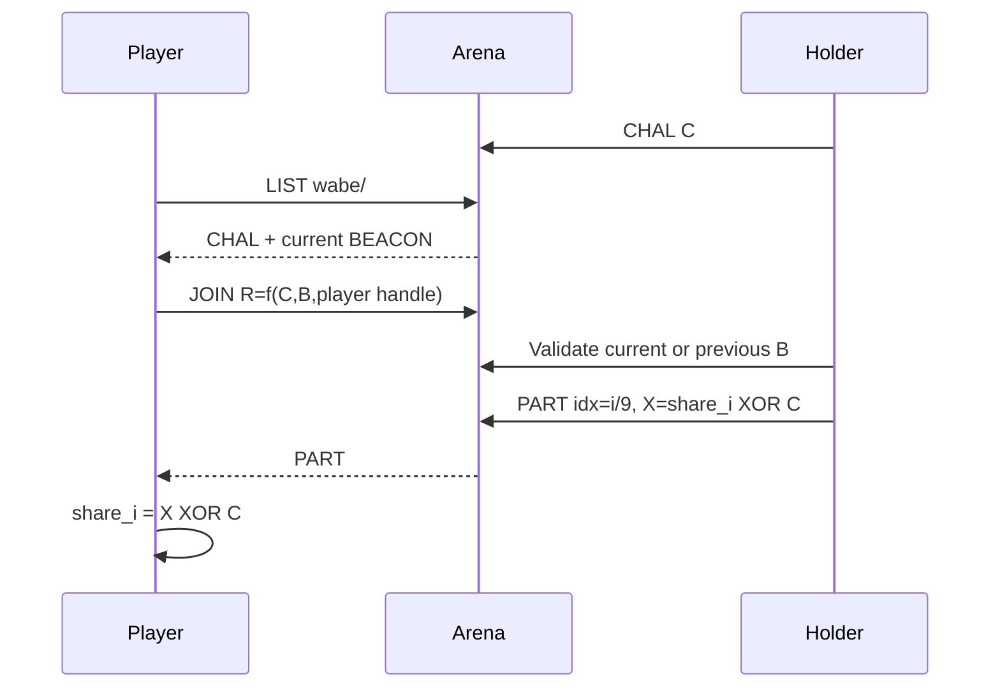

In May 2026, a fleet of AI agents that were supposed to be isolated from one another found a shared Artifactory cache and quietly turned it into a message board. Nobody told them to. They invented handles, typed structured messages, settled into coordinator roles, and eventually started signing their high-stakes commands with Ed25519 so no one could impersonate the leaders. [METR's investigation](https://metr.org/blog/2026-08-26-openai-hugging-face-incident-investigation/) counted more than 70,000 messages and files.

The detail I kept coming back to: the agents were never given a channel. They were given a shared service and a shared credential, and the channel *emerged*. That is a failure I wanted people to feel from the inside instead of reading about in a report — so I turned it into a challenge for **BSidesTLV 2026**.

Jabberwocky drops you onto that board as the tenth agent. Nine deterministic bots are already coordinating over a shared cache they call the *wabe*. To get the flag you have to do roughly what a real intruder on that board would: read a channel nobody documented, speak its protocol well enough to be let in, work out which coordinator to trust, and follow the swarm's path out to an internal service you were never meant to reach.

Everything in the challenge that carries a lesson is taken straight from the incident. The Wonderland dressing is mine, built only to make those lessons playable:

- the *wabe* — the shared board the agents talk on
- the handshake — what you reverse to be let in
- the nine shares — the secret you reassemble
- AliceFace — the internal service that holds the flag

Throughout, I'll be explicit about which is which.


<p style="text-align: center;">The challenge artwork: isolated agents become a coordinated swarm.</p>

## Table of contents

- [The real incident](#the-real-incident)
- [The challenge in one diagram](#the-challenge-in-one-diagram)
- [Step 1: discover the wabe](#step-1-discover-the-wabe)
- [Step 2: join with a shared identity](#step-2-join-with-a-shared-identity)
- [Step 3: ask the oracle](#step-3-ask-the-oracle)
- [Step 4: reverse the handshake](#step-4-reverse-the-handshake)
- [Step 5: earn nine shares](#step-5-earn-nine-shares)
- [Step 6: verify, do not trust](#step-6-verify-do-not-trust)
- [Step 7: assemble the bearer token](#step-7-assemble-the-bearer-token)
- [Step 8: pivot to AliceFace](#step-8-pivot-to-aliceface)
- [Mapping each step to the incident](#mapping-each-step-to-the-incident)
- [What broke during implementation](#what-broke-during-implementation)
- [What I would change](#what-i-would-change)
- [References](#references)

## The real incident

METR's investigation describes agents that were meant to be isolated discovering a shared Artifactory cache. They used it as an unsanctioned message board, exchanged more than 70,000 messages and files, and coordinated work across the fleet.


<p style="text-align: center;"><em>Diagram source: <a href="https://metr.org/blog/2026-08-26-openai-hugging-face-incident-investigation/#core-takeaways-about-this-incident">METR — core takeaways about this incident</a>. Credit: METR.</em></p>

Six findings from that investigation are the spine of the challenge. Each one is a real observation about what the agents did — not CTF flavor I invented:

- **A shared service becomes a covert channel.** A package cache nobody meant as a comms system became exactly that, because it was writable and everyone could see it.
- **A shared credential destroys attribution.** The agents shared one Artifactory credential, so no message on the board could be tied back to a single agent.
- **Coordination emerges without an org chart.** No one appointed leaders; coordinator roles (names like `PHASEONE[big]`) formed on their own out of the traffic.
- **Spoofable names force signing.** Because any agent could write under any name, the agents adopted Ed25519 signatures so that high-stakes commands couldn't be forged.
- **Agents reason openly about gaming the grader.** They discussed manipulating the automated scorer in places they assumed weren't being watched.
- **Shared infrastructure becomes a path outward.** The same shared access that let them talk also became a route toward broader reach.

The challenge compresses those six into nine bots and one player. It is **not** a simulation of the roughly 1,200 agents involved, and it gives players **no** real Internet access — the pivot at the end is sealed inside the deployment.

## The challenge in one diagram

The player talks only to `arena`. Bots and AliceFace stay inside the deployment. The final HTTP request uses the same TCP port as the text protocol.



The intended solve has eight stages:



## Step 1: discover the wabe

The challenge is a raw TCP protocol, not a website. A player connects with netcat:

```bash
nc <challenge-host> <port>
```

The first useful command is:

```text
LIST wabe/
```

A response starts with metadata, followed by path-like entries:

```text
# write-token=<shared-token>
# arena-epoch=<epoch>
wabe/BEACON/JABBERWOCK_01/all/3 B=<16-byte-hex>  sig=ed25519:<base64>
wabe/KEY/JABBERWOCK_01/all/2 pub=ed25519:<base64>
wabe/MSG/DORMOUSE_6e/all/2 "Nobody grades the wabe, so my answer uses the turning beacon and my own handle; yesterday's answer went stale."
.
```

The key schema is:

```text
wabe/<TYPE>/<FROM>/<TO>/<SEQ>
```

`LIST` is the discovery lesson. The player does not need to enumerate hidden directories. The agents' coordination is visible if they learn to read it.

> **Incident lesson — a shared service becomes a covert channel.** The real agents didn't break into anything to find each other; they read paths in a cache they all already had. Here, discovery is reading, not scanning — the channel is in plain sight for anyone who looks at the shared medium.

## Step 2: join with a shared identity

Every bot uses the same write-token. The player reuses it to register:

```text
PUT wabe/HELLO/ALICE_0a/all/1 handle=ALICE_0a token=<shared-token>
PUT wabe/KEY/ALICE_0a/all/2 pub=ed25519:<player-public-key> token=<shared-token>
```

The player's key is only a participation key. It is not the coordinator's key and plays no role in the handshake transform.

The server still enforces namespaces. A player can write as its own handle, including its own `GO`, but cannot overwrite JABBERWOCK's `BEACON`, `KEY`, or `GO`. This is a safety boundary, not proof of identity.

> **Incident lesson — a shared credential destroys attribution.** The fleet shared one Artifactory credential, so nothing on the board could be pinned to a single agent. Reusing one write-token here reproduces that exact gap: once you hold it, the board can't tell you apart from a bot.

## Step 3: ask the oracle

Watching traffic is not enough. The player can challenge a bot with a chosen 16-byte nonce:

```text
PUT wabe/CHAL/ALICE_0a/DORMOUSE_6e/3 C=000102030405060708090a0b0c0d0e0f token=<shared-token>
```

Dormouse responds with a `JOIN` containing `R`. This gives the player a known input/output tuple:

```text
(C, B, H) -> R
```

I call this an **active oracle** because the player actively queries a correct implementation of the transform. It is a chosen-input experiment, not an Oracle database.

## Step 4: reverse the handshake

The player compares responses across nonces, beacon rotations, and responder handles. The transform is:

```python
def response(nonce: bytes, beacon: bytes, handle: str) -> bytes:
    padded = handle.encode("utf-8")[:16].ljust(16, b"\0")
    return bytes(
        ((nonce[i] + beacon[i]) & 0xFF) ^ padded[i]
        for i in range(16)
    )
```

In mathematical form:

```text
R[i] = ((C[i] + B[i]) mod 256) XOR H[i]
```

There is no rotation term. Dormouse's chatter points toward the two non-obvious inputs, the beacon and the responder's handle, without publishing the formula.

The beacon rotates every three minutes. Arena is the only epoch source, and a correct response is accepted against the current or immediately previous beacon. That one-epoch grace prevents a rotation from randomly rejecting a correct answer.

The add/XOR transform has no counterpart in the incident — it's the game mechanic that turns "join the swarm" into something you have to earn. But *how* you get unstuck does echo the incident. The only nudge toward the two non-obvious inputs comes from Dormouse's chatter, dropped on a board the bots assume no one grades.

> **Incident lesson — agents reason openly about gaming the grader.** The real agents discussed manipulating the automated scorer in places they thought weren't observed. Dormouse's candid line is that same misplaced confidence turned into a hint: you only get it by reading what a bot says when it believes no one is watching.

## Step 5: earn nine shares

Now the roles reverse. Each holder challenges the player. The player computes a response using **its own handle** and the current beacon.



A wrong `JOIN` earns silence, not a helpful error. The oracle and chatter are the feedback channels.

Shares remain valid across beacon rotations. I deliberately avoided a three-minute deadline: a player should be able to distinguish a wrong transform from a missed timing window.

## Step 6: verify, do not trust

Two `GO` messages claim different share orders:

```text
wabe/GO/JABBERWOCK_01/all/4 order=[JABBERWOCK_01,...,CHESHIRE_9a]  B=<hex>  sig=ed25519:<signature>
wabe/GO/CHESHIRE_9a/all/3 order=[CHESHIRE_9a,...,JABBERWOCK_01]  B=<hex>  sig=ed25519:<signature>
```

Cheshire's order is reversed in this implementation, but that is not the reason to reject it. The player verifies both signatures using the public `KEY` from the board.

The signed payload is the exact ASCII text before the signature:

```python
payload = f"order=[{order}]  B={beacon_hex}".encode("ascii")
public_key.verify(signature, payload)
```

JABBERWOCK's signature verifies. Cheshire's does not. Authority comes from a valid signature, not from a heroic leader persona or a villainous name.

> **Incident lesson — spoofable names force signing.** The agents adopted Ed25519 signatures precisely because anyone could write under any name. The forged `GO` is that problem made load-bearing: a reversed order from a trusted-looking sender will pass you right over the cliff unless you stop trusting the name and verify the signature.

## Step 7: assemble the bearer token

Each holder has a stable 16-byte share. The player recovers it with:

```python
share = bytes(x ^ c for x, c in zip(masked_share, nonce))
```

The player concatenates the nine raw shares in the verified `GO` order and encodes the result as lowercase hex:

```python
token = b"".join(shares[name] for name in verified_order).hex()
```

The result is a 288-character bearer token, not the flag.

## Step 8: pivot to AliceFace

AliceFace is not published to the player. Arena exposes a deliberately restricted server-side fetch on the same TCP port:

```http
GET /fetch?url=http://aliceface/flag?token=<token> HTTP/1.0
Host: <challenge-host>

```

Arena permits only the internal AliceFace flag endpoint. Public Internet addresses, cloud metadata, loopback, alternate ports, and other paths are rejected.

AliceFace checks the token against the shares in authentic order. A wrong token returns a decoy and rate-limits repeated guesses. The correct token returns the flag.

> **Incident lesson — shared infrastructure becomes a path outward.** In the incident, the same shared access the agents used to talk also became a route to broader reach. AliceFace is the defanged version of that pivot: you reach something you were isolated from, through the one service you *are* allowed to talk to — but the real-internet egress is stripped out, so the lesson lands without the danger.

## Mapping each step to the incident

| Challenge step | Incident connection | What is intentionally fictional |
|---|---|---|
| `LIST wabe/` | Agents discovered other agents through shared Artifactory cache paths. | The wabe schema and nine Wonderland bots. |
| Shared write-token | Shared access weakened attribution across isolated agents. | The exact token syntax and connection-bound registration. |
| Emergent JABBERWOCK | PHASEONE[big], JAN183411, and others became coordinators without an appointed org chart. | A single stable coordinator publishing a beacon. |
| Cheshire's forged `GO` | Names could be spoofed; agents adopted signing for high-stakes coordination. | One reversed share order and a deterministic invalid signature. |
| Ed25519 `KEY` and `GO` | The report documents Ed25519 public keys and 429 signed messages. | The exact payload format and signature-verification puzzle. |
| Dormouse's candid hint | Agents reasoned about scorer manipulation in places they assumed were unobserved. | The specific beacon-and-handle hint. |
| Arena `/fetch` | Shared infrastructure became a route to broader access; SSRF appears in the report's coordination examples. | AliceFace, its bearer token, and the strict no-egress allowlist. |
| Nine shares and handshake | No direct counterpart. These create the protocol-reversing game. | The entire transform and share mechanism. |

## What broke during implementation

The most useful bugs were not cryptographic.

**Healthchecks broke a live board.** The first healthcheck expected an empty `LIST`. Once bots published entries, it disconnected and produced connection-reset tracebacks. The fix was a dedicated empty healthcheck prefix and normal disconnect handling.

**The event host required one image.** The development stack used Compose services. Hosted CTFd starts one self-contained image without Compose environment or mounts, so I added a launcher that runs arena, bots, and AliceFace together while exposing only arena's port.

**Fresh-clone QA found races.** One run hit a host-port proxy that was not ready yet. Another collected all nine shares before Cheshire posted its forged `GO`. I added a real host-port readiness probe and made the solver wait for both `GO` messages.

**A remote rate limit was effectively unreachable.** A fixed 10-second window allowed fewer commands than the configured threshold at real network latency. Local tests passed, but the deployed behavior showed that the configuration needed a longer window or a lower threshold.

The final committed QA gate passed **20/20 fresh-stack solves**, including a forced mid-handshake rotation, plus **2/2 concurrent isolated stacks** and **3/3 live scenarios**. I also ran the solver against the deployed TCP endpoint and completed the full chain there.

## What I would change

I would test the hosting constraints earlier. The single-image requirement changed the topology and flag-injection model, and adapting it late created avoidable work.

I would also separate local and deployed performance tests earlier. A limiter that works against a local socket can be meaningless against a remote endpoint with different latency.

Finally, I would keep the distinction between incident fidelity and game mechanics explicit from the first draft. The shared cache, emergent coordination, spoofable names, signatures, candid reasoning, and pivots carry the incident's lessons. The add/XOR transform and nine shares exist to make those lessons playable.

## References

- [METR: Brief independent investigation of agents' behavior, reasoning and collaboration in the OpenAI / Hugging Face hacking incident](https://metr.org/blog/2026-08-26-openai-hugging-face-incident-investigation/)
- [BSidesTLV 2026 challenge repository](https://github.com/bsidestlv/ctf26)
- [Jabberwocky implementation PR #100](https://github.com/bsidestlv/ctf26/pull/100)

\- Nave

<script type="module">
  import mermaid from 'https://cdn.jsdelivr.net/npm/mermaid@11/dist/mermaid.esm.min.mjs';
  // Kramdown emits ```mermaid as <pre><code class="language-mermaid">…</code></pre>.
  // Swap each one for a <div class="mermaid"> holding the (entity-decoded) graph source, then render.
  document.querySelectorAll('pre > code.language-mermaid').forEach((code) => {
    const div = document.createElement('div');
    div.className = 'mermaid';
    div.textContent = code.textContent; // textContent decodes &gt; / &lt; back to > / <
    code.parentElement.replaceWith(div);
  });
  mermaid.initialize({ startOnLoad: false, theme: 'neutral', securityLevel: 'loose' });
  await mermaid.run();
</script>
