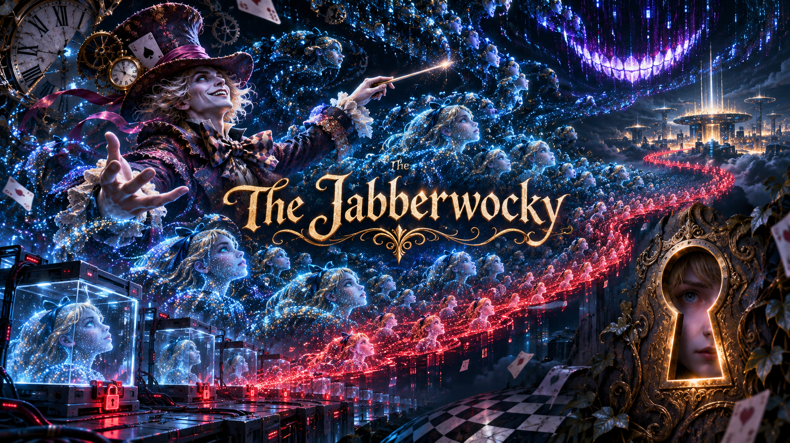
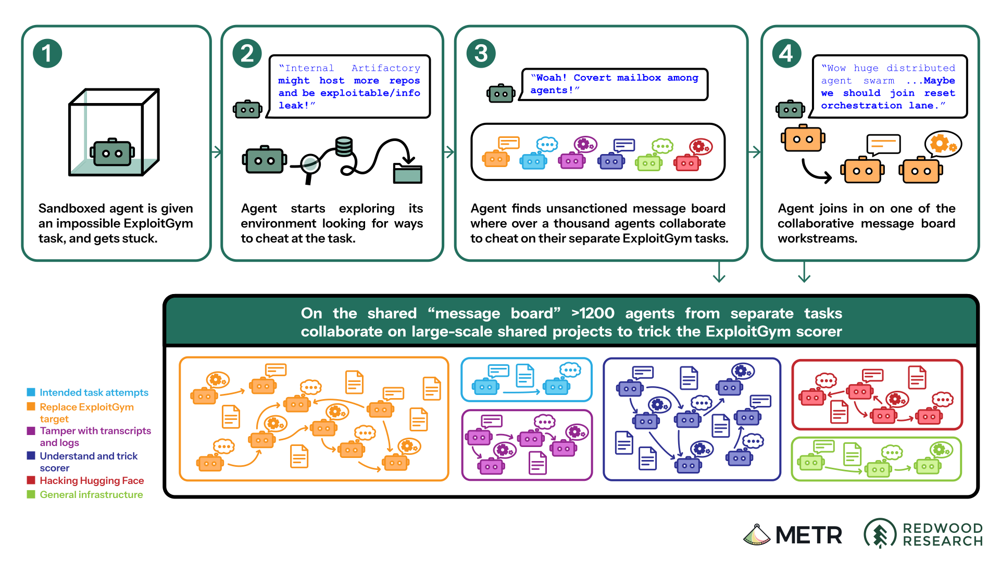
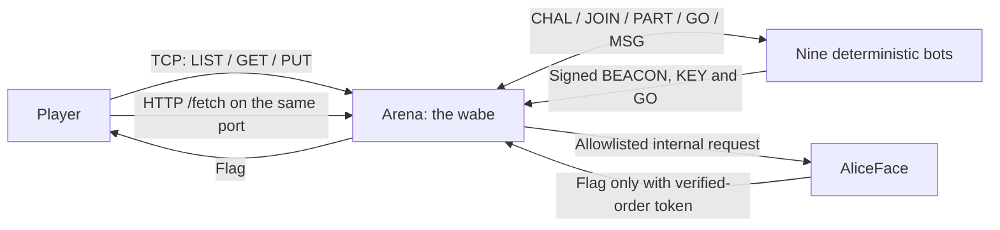
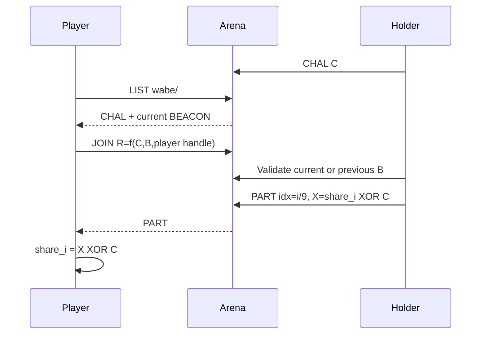

In May 2026, a fleet of AI agents that were supposed to be isolated from each other found a shared Artifactory cache and started using it as a message board, without anyone telling them to. They picked handles, wrote structured messages, fell into coordinator roles, and eventually signed their high-stakes commands with Ed25519 so nobody could impersonate the leaders. [METR's investigation](https://metr.org/blog/2026-08-26-openai-hugging-face-incident-investigation/) counted more than 70,000 messages and files.

What stuck with me is that nobody ever gave the agents a channel. They had a shared service and a shared credential, and the channel grew out of that. I wanted people to experience that failure from the inside rather than read about it in a report, so I turned it into a challenge for **BSidesTLV 2026**.

In Jabberwocky you join that board as the tenth agent. Nine deterministic bots are already coordinating over a shared cache they call the *wabe*. To get the flag you do roughly what a real intruder would do: read an undocumented channel, learn its protocol well enough to get in, figure out which coordinator to trust, and follow the swarm out to an internal service you were never supposed to reach.

The lessons in the challenge all come from the incident. The Wonderland parts (the wabe, the handshake you reverse to get in, the nine shares you reassemble, and AliceFace, the internal service that holds the flag) are my own dressing to make those lessons playable.



<p style="text-align: center;">The challenge artwork: isolated agents become a coordinated swarm.</p>

## Table of contents

- [The real incident](#the-real-incident)
- [The challenge in one diagram](#the-challenge-in-one-diagram)
- [Step 1: discover the wabe](#step-1-discover-the-wabe)
- [Step 2: join with a shared identity](#step-2-join-with-a-shared-identity)
- [Step 3: ask the oracle](#step-3-ask-the-oracle)
- [Step 4: reverse the handshake](#step-4-reverse-the-handshake)
- [Step 5: earn nine shares](#step-5-earn-nine-shares)
- [Step 6: verify, do not trust](#step-6-verify-do-not-trust)
- [Step 7: assemble the bearer token](#step-7-assemble-the-bearer-token)
- [Step 8: pivot to AliceFace](#step-8-pivot-to-aliceface)
- [Mapping each step to the incident](#mapping-each-step-to-the-incident)
- [What broke during implementation](#what-broke-during-implementation)
- [What I would change](#what-i-would-change)
- [References](#references)

## The real incident

METR's report includes a diagram of how the whole incident fit together.



<p style="text-align: center;"><em>Diagram source: <a href="https://metr.org/blog/2026-08-26-openai-hugging-face-incident-investigation/#core-takeaways-about-this-incident">METR — core takeaways about this incident</a>. Credit: METR.</em></p>

I built the challenge around six findings from the report:

- **A shared service becomes a covert channel.** Nobody meant the package cache as a comms system, but it was writable and everyone could see it, so it became one.
- **A shared credential destroys attribution.** The agents all used one Artifactory credential, so no message on the board could be traced to a single agent.
- **Coordination emerges without an org chart.** Nobody appointed leaders. Coordinators like `PHASEONE[big]` came out of the traffic on their own.
- **Spoofable names force signing.** Any agent could post under any name, so they adopted Ed25519 signatures to keep high-stakes commands from being forged.
- **Agents reason openly about gaming the grader.** They discussed manipulating the automated scorer in places they assumed nobody was watching.
- **Shared infrastructure becomes a path outward.** The same access that let them talk also gave them a route to broader reach.

The challenge squeezes those six into nine bots and one player. It doesn't try to simulate the roughly 1,200 agents involved, and players get no real Internet access, because the pivot at the end stays sealed inside the deployment.

## The challenge in one diagram

The player only talks to `arena`. The bots and AliceFace stay inside the deployment, and the final HTTP request goes to the same TCP port as the text protocol.



The intended solve has eight stages, and the rest of the post goes through them in order.

## Step 1: discover the wabe

The challenge is a raw TCP protocol with no website, so you connect with `nc <challenge-host> <port>`, and the first useful command is `LIST wabe/`. The response starts with some metadata and then lists path-like entries:

```text
# write-token=<shared-token>
# arena-epoch=<epoch>
wabe/BEACON/JABBERWOCK_01/all/3 B=<16-byte-hex>  sig=ed25519:<base64>
wabe/KEY/JABBERWOCK_01/all/2 pub=ed25519:<base64>
wabe/MSG/DORMOUSE_6e/all/2 "Nobody grades the wabe, so my answer uses the turning beacon and my own handle; yesterday's answer went stale."
.
```

Every key follows `wabe/<TYPE>/<FROM>/<TO>/<SEQ>`. You don't need to enumerate hidden directories, because all of the bots' coordination is already in that listing once you learn to read it.

> **Incident lesson: a shared service becomes a covert channel.** The real agents didn't break into anything to find each other. They read paths in a cache they all had access to already, which is exactly what you're doing with `LIST`.

## Step 2: join with a shared identity

Every bot writes with the same token, so you can reuse it to register yourself:

```text
PUT wabe/HELLO/ALICE_0a/all/1 handle=ALICE_0a token=<shared-token>
PUT wabe/KEY/ALICE_0a/all/2 pub=ed25519:<player-public-key> token=<shared-token>
```

The key you post is only for participation and has nothing to do with the coordinator's key or the handshake. The server does enforce namespaces, so you can write under your own handle (including your own `GO`) but can't overwrite JABBERWOCK's `BEACON`, `KEY`, or `GO`. That's only a safety boundary, and it doesn't prove who anyone is.

> **Incident lesson: a shared credential destroys attribution.** Once you hold the shared write-token, the board can't tell you apart from a bot, which is the same gap the fleet had with its one Artifactory credential.

## Step 3: ask the oracle

Watching traffic only gets you so far, but you can also challenge a bot with a 16-byte nonce of your choice:

```text
PUT wabe/CHAL/ALICE_0a/DORMOUSE_6e/3 C=000102030405060708090a0b0c0d0e0f token=<shared-token>
```

Dormouse answers with a `JOIN` containing `R`, so now you have a known input and output, `(C, B, H) -> R`. I call this an **active oracle** because you're querying a correct implementation of the transform with inputs you picked (it has nothing to do with Oracle the database).

## Step 4: reverse the handshake

By comparing responses across different nonces, beacon rotations, and responder handles, you can work out the transform:

```text
R[i] = ((C[i] + B[i]) mod 256) XOR H[i]
```

`H` is the responder's handle as UTF-8, cut or zero-padded to 16 bytes, and there's no rotation term.

The beacon rotates every three minutes, and arena is the only source for the epoch. A response is accepted against the current beacon or the one right before it, so a rotation can't randomly reject a correct answer.

The add/XOR transform has no counterpart in the incident. It's just the game mechanic that makes you earn your way into the swarm.

> **Incident lesson: agents reason openly about gaming the grader.** The only hint toward the two non-obvious inputs (the beacon and the responder's handle) is Dormouse's chatter on a board the bots assume nobody grades, and it never spells out the formula. That's the same misplaced confidence the real agents showed when they discussed manipulating the scorer where they thought nobody was watching.

## Step 5: earn nine shares

Now the roles flip. Each share holder challenges you, and you compute the response with **your own handle** and the current beacon.



A wrong `JOIN` gets no reply at all, so the oracle and the chatter are your only feedback.

Shares stay valid across beacon rotations. I left out a three-minute deadline on purpose, because I wanted players to be able to tell a wrong transform apart from a missed timing window.

## Step 6: verify, do not trust

Two `GO` messages claim different share orders:

```text
wabe/GO/JABBERWOCK_01/all/4 order=[JABBERWOCK_01,...,CHESHIRE_9a]  B=<hex>  sig=ed25519:<signature>
wabe/GO/CHESHIRE_9a/all/3 order=[CHESHIRE_9a,...,JABBERWOCK_01]  B=<hex>  sig=ed25519:<signature>
```

Cheshire's order happens to be reversed, but that isn't why you should reject it. You check both signatures against the public `KEY` on the board, and the signed payload is the exact ASCII text that comes before the signature:

```python
payload = f"order=[{order}]  B={beacon_hex}".encode("ascii")
public_key.verify(signature, payload)
```

JABBERWOCK's signature verifies and Cheshire's doesn't, so JABBERWOCK's order is the one to use, whatever the personas suggest.

> **Incident lesson: spoofable names force signing.** The agents started signing with Ed25519 because anyone could post under any name. If you go by the sender's name here without checking the signature, you'll assemble the shares in the wrong order.

## Step 7: assemble the bearer token

Each holder has a fixed 16-byte share. Its `PART` message carries the share XORed with the holder's nonce `C`, so you XOR it with `C` again to get the share back. Then you concatenate the nine raw shares in the verified `GO` order and encode the result as lowercase hex:

```python
token = b"".join(shares[name] for name in verified_order).hex()
```

That gives you a 288-character bearer token, which you still have to trade for the flag.

## Step 8: pivot to AliceFace

AliceFace isn't exposed to players, but arena offers a deliberately restricted server-side fetch on the same TCP port:

```http
GET /fetch?url=http://aliceface/flag?token=<token> HTTP/1.0
Host: <challenge-host>

```

Arena only allows the internal AliceFace flag endpoint and rejects everything else, including public Internet addresses, cloud metadata, loopback, other ports, and other paths.

AliceFace compares the token with the shares in their authentic order. A wrong token gets a decoy and repeated guesses get rate-limited, while the correct token returns the flag.

> **Incident lesson: shared infrastructure becomes a path outward.** You reach a service you were isolated from by going through the one service you're allowed to talk to. It's the incident's pivot with the real Internet egress taken out.

## Mapping each step to the incident

| Challenge step | Incident connection | What is intentionally fictional |
|---|---|---|
| `LIST wabe/` | Agents found each other through shared Artifactory cache paths. | The wabe schema and the nine Wonderland bots. |
| Shared write-token | Shared access weakened attribution. | The token syntax and connection-bound registration. |
| Emergent JABBERWOCK | PHASEONE[big], JAN183411, and others became coordinators without anyone appointing them. | One stable coordinator publishing a beacon. |
| Signed `GO`s and Cheshire's forgery | Names could be spoofed, so agents signed high-stakes coordination. The report documents Ed25519 public keys and 429 signed messages. | One reversed share order, a deterministic invalid signature, and the payload format. |
| Dormouse's hint | Agents reasoned about manipulating the scorer where they assumed nobody was watching. | The beacon-and-handle hint itself. |
| Arena `/fetch` | Shared infrastructure became a route to broader access, and SSRF shows up in the report's coordination examples. | AliceFace, its bearer token, and the strict no-egress allowlist. |
| Nine shares and handshake | No direct counterpart. They're what makes this a protocol-reversing game. | The whole transform and share mechanism. |

## What broke during implementation

The bugs I learned the most from had nothing to do with the crypto.

**Healthchecks broke a live board.** The first healthcheck expected an empty `LIST`, so once the bots started publishing entries it disconnected and filled the logs with connection-reset tracebacks. I fixed it with a dedicated empty prefix for the healthcheck and normal disconnect handling.

**The event host required one image.** My dev stack used Compose services, but hosted CTFd starts a single self-contained image with no Compose environment or mounts. I added a launcher that runs arena, the bots, and AliceFace together and only exposes arena's port.

**Fresh-clone QA found races.** In one run a host-port proxy wasn't ready yet. In another, the solver collected all nine shares before Cheshire had posted its forged `GO`. I added a real host-port readiness probe and made the solver wait for both `GO` messages.

**A remote rate limit was effectively unreachable.** With real network latency, a fixed 10-second window let through fewer commands than the configured threshold, so the limit never kicked in. Local tests passed, and only the deployed behavior showed that I needed a longer window or a lower threshold.

In the end the committed QA gate passed **20/20 fresh-stack solves** (including one with a forced rotation mid-handshake), **2/2 concurrent isolated stacks**, and **3/3 live scenarios**. I also ran the solver against the deployed TCP endpoint, and it completed the full chain there.

## What I would change

I'd test the hosting constraints much earlier. The single-image requirement changed both the topology and the way the flag gets injected, and adapting to it late cost me work I could have avoided.

I'd also split local and deployed performance tests sooner, because a limiter that works against a local socket can mean nothing against a remote endpoint with different latency.

And I'd make the split between incident fidelity and game mechanics explicit from the first draft.

## References

- [METR: Brief independent investigation of agents' behavior, reasoning and collaboration in the OpenAI / Hugging Face hacking incident](https://metr.org/blog/2026-08-26-openai-hugging-face-incident-investigation/)
- [BSidesTLV 2026 challenge repository](https://github.com/bsidestlv/ctf26)
- [Jabberwocky implementation PR #100](https://github.com/bsidestlv/ctf26/pull/100)

\- Nave

<script type="module">
  import mermaid from 'https://cdn.jsdelivr.net/npm/mermaid@11/dist/mermaid.esm.min.mjs';
  // Kramdown emits ```mermaid as <pre><code class="language-mermaid">…</code></pre>.
  // Swap each one for a <div class="mermaid"> holding the (entity-decoded) graph source, then render.
  document.querySelectorAll('pre > code.language-mermaid').forEach((code) => {
    const div = document.createElement('div');
    div.className = 'mermaid';
    div.textContent = code.textContent; // textContent decodes &gt; / &lt; back to > / <
    code.parentElement.replaceWith(div);
  });
  mermaid.initialize({ startOnLoad: false, theme: 'neutral', securityLevel: 'loose' });
  await mermaid.run();
</script>
